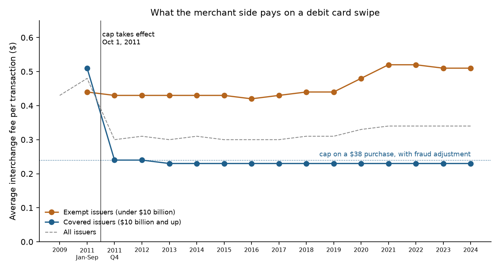
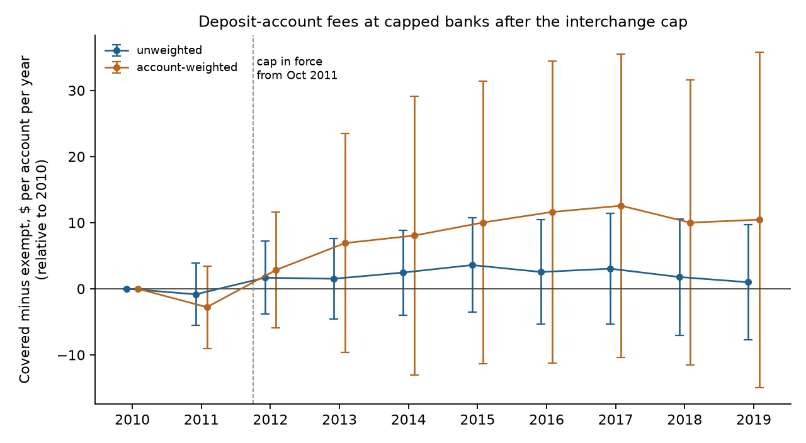
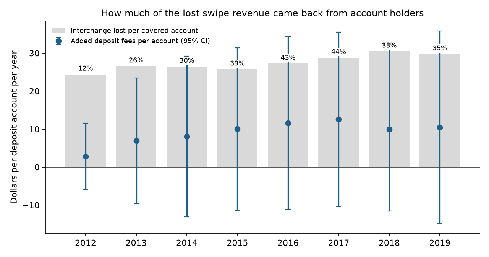

# The Other Side of the Swipe

### In 2003, Jean-Charles Rochet and Jean Tirole asked how a business that serves two groups of customers should split its price between them. When Congress cut the price on the merchants' side of the debit card in 2011, I asked whether the banks moved it to the cardholders' side.

---

On September 29, 2011, news broke that Bank of America planned to charge its customers $5 a month for using a debit card to buy things. The bank pointed to a new federal rule. Two days later, on October 1, the Durbin Amendment to the Dodd-Frank Act began capping the fee that a large bank collects every time one of its debit cards is swiped. Customers objected, Senator Dick Durbin attacked the bank by name, and on November 1 Bank of America dropped the plan, shortly after JPMorgan Chase had ended a $3 test of its own.

The fee the rule capped is invisible to the person holding the card. In 2009 the average debit card purchase in the United States was $38.18, and on it the merchant paid the card's issuing bank, through the merchant's own bank, an interchange fee averaging 43 cents, or 1.13% of the sale. The cardholder paid nothing per swipe and, on average, received about 4 cents of rewards. Once the cap took effect, banks with $10 billion or more in assets saw their average fee fall from 50 cents to 24 cents a transaction. Bank of America's $5 fee was an attempt to collect from one side of the swipe what the law had taken away on the other. Two economists in Toulouse had worked out the logic of that move eight years earlier, with payment cards as their leading example.

---

## Two prices for one swipe

A debit card network is what economists now call a two-sided platform. It is worth something to a shopper only if stores take the card, and worth something to a store only if shoppers carry it. Every transaction therefore has two prices, one charged to the merchant, $`p^S`$, and one charged to the cardholder, $`p^B`$ (B for buyer). Their sum is the total price of the transaction, and the platform's cost of processing it is $`c`$. Rochet and Tirole showed that a profit-maximizing platform sets the total by the textbook markup rule, using the combined elasticity of both sides, and splits it in proportion to each side's own elasticity:

```math
\frac{p - c}{p} = \frac{1}{\eta^B + \eta^S}, \qquad p = p^B + p^S, \qquad \frac{p^B}{\eta^B} = \frac{p^S}{\eta^S}
```

Here $`\eta^S`$ is the percentage drop in merchants' use of the card for a 1% rise in their price, and $`\eta^B`$ is the same for cardholders. The side that responds less to its price pays more of the total. In 2009 the merchant price was 43.1 cents, the cardholder price was minus 4 cents in rewards, and the Federal Reserve measured the average cost to a large issuer of authorizing, clearing and settling a transaction at 7.7 cents.

```math
\begin{aligned}
p &= 0.431 - 0.040 = 0.391 \\
\frac{p - c}{p} &= \frac{0.391 - 0.077}{0.391} = 0.80 \\
\eta^S &= \frac{p^S}{p - c} = \frac{0.431}{0.314} = 1.37
\end{aligned}
```

Read through the formula, those prices treat merchants as the side that would keep paying and cardholders as a side worth paying to sign up. The merchant price was 5.6 times the processing cost. That is the structure Rochet and Tirole's Table 1 lists for credit and deferred debit cards, with cardholders subsidized and merchants the profit center.

The second measure is the one this study turns on. When a regulator forces the merchant price down, a platform can raise the cardholder price to recover some of the loss. I call the share it recovers the offset ratio:

```math
\rho = -\frac{\Delta p^B}{\Delta p^S} = \frac{\text{added fees collected from cardholders}}{\text{interchange revenue lost on the merchant side}}
```

In 2012, the first full year of the cap, covered banks processed 33.2 billion debit transactions at 26 cents less than before, giving up $8.63 billion. Spread across the 354 million deposit accounts at those banks, that is

```math
L_{2012} = \frac{(0.50 - 0.24) \times 33.2 \text{ billion}}{354 \text{ million accounts}} = \$24.40 \text{ per account per year}
```

so a bank that recovered all of it would have raised account fees by about $24 a year per account. The ratio has three benchmark values.

| Offset ratio | What it means | Which theory predicts it |
|---|---|---|
| 0 | Banks absorb the whole cut; cardholders pay nothing more | A one-sided market, where the cardholder price is set without regard to the other side |
| Between 0 and 1 | Banks recover part of the cut from cardholders | Rochet and Tirole's platform with market power and well-behaved demand |
| 1 | Banks recover every dollar; the total price is unchanged | Perfectly competitive issuers, or a market where only the total price matters |

---

## Rochet and Tirole's question

Jean Tirole was born in Troyes, France, in 1953, earned his doctorate at MIT in 1981 under Eric Maskin, taught at MIT, and returned to France to become scientific director of the Institut d'Économie Industrielle in Toulouse and later chairman of the Toulouse School of Economics. Jean-Charles Rochet is a specialist in banking who wrote the textbook *Microeconomics of Banking* with Xavier Freixas and later taught at the University of Zurich. Both were at Toulouse when they wrote "Platform Competition in Two-Sided Markets," published in the first volume of the *Journal of the European Economic Association* in 2003. In 2014 Tirole received the Nobel Memorial Prize in Economic Sciences "for his analysis of market power and regulation."

The paper begins with video game consoles and payment cards and argues that platforms in these industries must, in its words, "get both sides of the market on board." Its Table 1 sorts fifteen industries by which side is the loss leader. Consoles are sold cheap and games carry royalties. Newspapers are cheap and advertisers pay. Credit cards court cardholders and charge merchants. The online, PIN-based debit card of the time had the opposite model, keeping its merchant fee low because shoppers already carried ATM cards while stores still had to install PIN pads. The Federal Reserve's 2009 data show that difference surviving. The average signature debit transaction cost merchants 55.0 cents, and the average PIN transaction 23.5 cents.

The central result is Proposition 1. Suppose the platform charges $`p^B`$ and $`p^S`$ per transaction, each side joins independently, and the number of transactions is the product of the two sides' demands, $`D^B(p^B)\,D^S(p^S)`$, each log-concave (the standard assumption that demand does not get more elastic as price falls). Profit and its first-order conditions are

```math
\begin{aligned}
\pi &= (p^B + p^S - c)\, D^B(p^B)\, D^S(p^S) \\
\frac{\partial \ln \pi}{\partial p^B} &= \frac{1}{p^B + p^S - c} + \frac{D^{B\prime}(p^B)}{D^B(p^B)} = 0 \;\Rightarrow\; p^B + p^S - c = \frac{p^B}{\eta^B} \\
\frac{\partial \ln \pi}{\partial p^S} &= 0 \;\Rightarrow\; p^B + p^S - c = \frac{p^S}{\eta^S} \\
\Rightarrow\; \frac{p^B}{\eta^B} &= \frac{p^S}{\eta^S} = p - c \;\Rightarrow\; \frac{p - c}{p} = \frac{1}{\eta^B + \eta^S}
\end{aligned}
```

The last line adds the two conditions after multiplying each by its elasticity. In words, the platform cares about the total margin, and it collects that margin from whichever side will bear it.

The same algebra gives the prediction tested here. Fix the merchant price at a cap $`\bar a`$ and let the platform reset only the cardholder price. Writing $`m(p) = -D^B(p)/D^{B\prime}(p) = p/\eta^B`$, which log-concavity makes non-increasing,

```math
\begin{aligned}
p^B + \bar a - c &= m(p^B) \\
dp^B + d\bar a &= m'(p^B)\, dp^B \\
\rho \equiv -\frac{dp^B}{d\bar a} &= \frac{1}{1 - m'(p^B)} \in (0,\, 1] \quad \text{since } m' \le 0 \\
D^B(p) = 1 - p \;&\Rightarrow\; m'(p) = -1 \;\Rightarrow\; \rho = \tfrac{1}{2}
\end{aligned}
```

A cap on the merchant side raises the cardholder price, but by less than the cut unless demand is of a knife-edge exponential form. The paper's Proposition 5 states the same mechanism the other way round, where a higher seller price lowers the effective cost of serving buyers and so lowers the buyer price.

The strongest objection to the paper concerns what it has been used for. In *Ohio v. American Express*, decided 5 to 4 on June 25, 2018, Justice Clarence Thomas's majority opinion cited Rochet and Tirole in holding that a card network's restrictions on merchants must be judged by their effect on both sides together, so that evidence of higher merchant fees alone did not prove harm. Justice Stephen Breyer, writing for the four dissenters, argued that such evidence should have been enough. The empirical question underneath the dispute is how strongly one side's price moves when the other's does. The Durbin cap is a direct test of it. Benjamin Kay, Mark Manuszak and Cindy Vojtech, then at the Treasury and the Federal Reserve, estimated in 2014 that higher deposit fees offset roughly 30% of covered banks' lost interchange income, and Manuszak and Krzysztof Wozniak found in 2017 that capped banks offered fewer free checking accounts and raised monthly fees, while exempt banks partly followed them. The question has only grown as platforms from app stores to ride-hailing set two prices at once.

---

## How I tested it

The paper is a theory paper, so I took its sharpest prediction that public data can reach, the size of $`\rho`$ when one side's price is capped, and measured it on the Durbin cap. The merchant side comes from the Federal Reserve Board's Regulation II surveys of networks and issuers, 2009 to 2024. The cardholder side comes from the call reports every FDIC-insured bank files. I used each bank's annual service charges on deposit accounts, which include monthly maintenance, overdraft and ATM fees, divided by its number of deposit accounts, a figure reported for every bank from 2010. I added banks up to their top holding company, because the cap applies to an issuer together with its affiliates. Groups with $10 billion or more of assets at the end of 2010 are covered; exempt groups of $1 billion to $10 billion are the comparison.

I fixed the sample rules before estimating, with one revision. I dropped credit card banks, groups whose 2010 fees per account were below $10 or above $400 (online savings banks, custody banks), groups that were not present in every year from 2010 to 2013, groups that crossed the $10 billion line, and groups where banks without service-charge data held more than 5% of accounts. A group's panel ends at the first year its account count moves 40% more than its deposits, a sign of a reporting change rather than a merger. The revision followed a first pass in which JPMorgan Chase fell out of the sample because its credit card bank's accounts were counted against it. From 530 groups the rules keep 341, 51 covered and 290 exempt, holding 328 million and 27 million deposit accounts in 2010. The estimating equation for group $`i`$ in year $`t`$ is

```math
\begin{aligned}
F_{it} &= \alpha_i + \lambda_t + \sum_{k \neq 2010} \beta_k \left(\text{Covered}_i \times \mathbf{1}[t = k]\right) + \varepsilon_{it} \\
H_0 &:\ \beta_k = 0, \qquad \hat\rho_w = \frac{\hat\beta_w}{L_w}
\end{aligned}
```

where $`F_{it}`$ is service charges per deposit account in dollars, winsorized at the 1st and 99th percentiles, $`\alpha_i`$ and $`\lambda_t`$ are group and year fixed effects, and $`\hat\beta_w`$ pools the years of a window. I report each regression unweighted and weighted by 2010 accounts. The weighted version describes the average account and converts into $`\rho`$ on division by $`L_w`$, the interchange lost per covered deposit account in the same years. Standard errors are clustered by holding company. The comparison assumes that without the cap, fees at large and small banks would have moved in parallel after 2010, and with account counts beginning in 2010, I cannot test that assumption on the main measure.

---

## Merchants paid for the debit card, and the cap cut their price in half

| Average interchange fee per transaction | Covered issuers | Exempt issuers |
|---|---|---|
| January to September 2011 | $0.50 | $0.44 |
| October to December 2011 | $0.24 | $0.43 |
| 2013 | $0.233 | $0.43 |
| 2019 | $0.227 | $0.44 |
| 2024 | $0.23 | $0.51 |

*The 2011 report gives 50 cents for covered issuers before the cap; the Fed's network file rounds the same figure to $0.51.*

The cap took effect overnight and has held ever since. Covered issuers have collected between 22.7 and 24 cents a transaction in every year from 2012 to 2024. The exempt side went the other way. Small issuers' average fee was 43 cents in 2012 and 51 cents in 2024, and on signature networks it rose from 51 cents to a peak of 64 cents in 2021 and 2022, so the old price structure is not only intact for small banks but steeper.



Covered banks gave up $8.63 billion in 2012 and $13.64 billion in 2019, when they processed 49.9 billion transactions.

---

## Depositors made up little of the lost swipe revenue

An exempt group's fee per account fell from $76.58 in 2010 to $69.38 in 2013, and a covered group's from $90.83 to $85.14, so the gap between them barely moved. Weighted by accounts, covered banks went from $80.14 to $79.26 while exempt banks went from $75.98 to $68.19, a relative rise of about $7.

```math
\begin{aligned}
\hat\beta_{2012\text{-}13} &= 4.87\ (6.24), \qquad N = 2{,}998 \\
\hat\rho &= \frac{4.87}{25.47} = 0.19,\quad 95\%\ \text{CI}\ [-0.29,\ 0.67],\quad z_{\rho = 1} = -3.30
\end{aligned}
```

In the account-weighted regression, covered banks raised fees by $4.87 per account per year in 2012 and 2013 relative to exempt banks, against $25.47 of interchange lost per account. The estimate is not distinguishable from zero, and it is clearly distinguishable from full recovery. Unweighted, the rise is $1.59 (standard error $2.88). Measured in logs it is 2.2 log points unweighted and 8.9 weighted, neither significant, which brackets the 3% to 5% rise in deposit fees that Kay, Manuszak and Vojtech found. Per $1,000 of domestic deposits, covered banks' service charges fell relative to exempt banks in 2012 and 2013, by 41 cents unweighted and 99 cents weighted, both clearly below zero. That measure was drifting down before the cap, so I do not read it as a fee cut, but it gives no support to a rise.



The weighted figure rests on a few very large banks pulling in opposite directions.

| Bank | Deposit accounts, millions, 2010 | Same, 2013 | Service charges, $ billions, 2010 to 2013 | Fee per account, 2010 | Fee per account, 2013 | Change relative to exempt banks |
|---|---|---|---|---|---|---|
| Wells Fargo | 108.6 | 78.8 | 4.92 to 5.08 | $45.33 | $64.50 | +$26.37 |
| Bank of America | 62.8 | 62.7 | 6.54 to 5.25 | $104.19 | $83.64 | −$13.35 |
| JPMorgan Chase | 45.6 | 45.8 | 4.65 to 4.47 | $102.06 | $97.59 | +$2.73 |
| PNC | 13.0 | 16.6 | 1.14 to 1.03 | $87.65 | $62.20 | −$18.24 |
| U.S. Bancorp | 12.7 | 15.9 | 1.27 to 1.21 | $99.32 | $76.04 | −$16.09 |
| BB&T | 8.5 | 7.7 | 0.62 to 0.58 | $72.86 | $75.62 | +$9.96 |
| Citizens | 7.7 | 5.9 | 0.61 to 0.49 | $79.87 | $83.66 | +$10.99 |
| Regions | 7.3 | 6.1 | 0.81 to 0.73 | $110.75 | $120.47 | +$16.93 |
| TD Bank | 6.7 | 6.7 | 0.70 to 0.93 | $105.06 | $138.28 | +$40.42 |
| Fifth Third | 5.7 | 5.6 | 0.56 to 0.54 | $97.87 | $95.98 | +$5.31 |
| Capital One | 5.1 | 13.0 | 0.37 to 0.35 | $71.18 | $26.47 | −$37.51 |

*Exempt groups' average fee per account fell $7.20 over the same years. Capital One's drop reflects its 2012 purchase of ING Direct, whose accounts carried almost no fees.*

Wells Fargo's rise of $19.17 per account comes mostly from the denominator. Its service charges grew about 3%, while the deposit accounts it reported fell from 108.6 million to 78.8 million as its deposits kept growing. The call reports cannot say whether those accounts were closed or counted differently, and because the fall was spread over two years, my 40% break rule did not catch it. Citizens and Regions show the same pattern on a smaller scale. TD Bank is the clearest case of higher charges on an unchanged base. Bank of America, the bank that backed down on the $5 fee, collected $20.55 less per account in 2013 than in 2010. Dropping Wells Fargo alone turns the weighted 2012–13 estimate to −$1.79 (standard error $4.53), and dropping JPMorgan Chase, Bank of America and Wells Fargo gives $0.79 ($4.55). Citigroup's accounts data already put it outside the sample.

---

## Ten years on, the recovered share is larger but no more certain

Following the same groups to 2019, the weighted gap widens to about $10 to $12 per account from 2015 on, while the interchange lost per account rises with debit use.

```math
\begin{aligned}
\hat\beta_{2017\text{-}19} &= 11.01\ (11.78) \\
\hat\rho &= \frac{11.01}{29.66} = 0.37,\quad 95\%\ \text{CI}\ [-0.41,\ 1.15],\quad z_{\rho = 1} = -1.58
\end{aligned}
```

| Years | Interchange lost per covered account | Added fees per account | Offset ratio | 95% interval |
|---|---|---|---|---|
| 2012–13 | $25.47 | $4.87 | 0.19 | −0.29 to 0.67 |
| 2014–16 | $26.47 | $9.80 | 0.37 | −0.45 to 1.19 |
| 2017–19 | $29.66 | $11.01 | 0.37 | −0.41 to 1.15 |



The point estimates rise from 19% to 37%, on either side of the 30% that Kay, Manuszak and Vojtech reported. But the panel thins as banks merge, the big banks' fee histories diverge, and by the later years the data can no longer rule out either zero or full recovery. Unweighted, the long-run gap is $1.97 (standard error $4.27), and without Wells Fargo the weighted 2017–19 estimate is −$4.07 ($4.76).

---

## Why it matters

For consumers, the cap's money mostly did not come back through bank fees, at least in the years when the data can measure it. Covered banks gave up about $25 a year in swipe revenue per deposit account and recovered at most about a fifth of it from service charges in 2012 and 2013, and nothing measurable once Wells Fargo is set aside. Whether shoppers gained depends on whether merchants passed their savings into prices, which this data cannot see, and on changes in card rewards, which the call reports do not record.

For merchants, the cap was a large and lasting price cut on most debit transactions, from 50 cents to about 23 cents. On cards from small banks, which were never capped, they paid 51 cents on average in 2024, more than in 2011.

For smaller banks, the exemption has grown more valuable. Their swipe revenue held while their account fees kept falling after 2010.

For policy, the result cuts against both strong positions in the *American Express* debate. The cardholder side did not stand still, which is the case for looking at both sides of a platform. But it moved far less than one for one, so treating the two sides as a single net price would have badly overstated what cardholders paid for the merchants' gain. In October 2023 the Federal Reserve proposed lowering the cap from 24.5 cents to 17.7 cents on a $50 purchase, and these numbers suggest that most of such a cut would stay with merchants rather than return through account fees.

---

## Limits of this study

Service charges per deposit account is a rough cardholder price. It counts savings and time deposit accounts that carry no debit card, mixes overdraft fees with monthly fees, and leaves out debit rewards, which the Fed's 2009 survey put at about 4 cents a transaction, and minimum-balance rules, so it can miss real increases. Overdraft rules changed in 2010, and the deposits-based version of the comparison shows covered banks' fees already falling relative to exempt banks before the cap (joint test of 2006 to 2009, p = 0.024 unweighted and p < 0.001 weighted), which would bias the estimate down. Manuszak and Wozniak found that exempt banks followed the capped banks' price increases, which also pushes the difference toward zero. Covered status here is built from bank subsidiaries' assets rather than the Fed's official list, credit unions are missing, and the interchange lost per account assumes debit use is spread evenly across covered banks' accounts. The Fed's covered transactions include credit unions and prepaid cards that have no accounts in my denominator, which pushes the offset ratio down somewhat. Mergers and changes in how accounts are counted end some panels and change the meaning of a fee per account in others.

---

## Further reading

- [TECHNICAL.md](TECHNICAL.md) has the data files, the rules, every test statistic and how to reproduce the results.
- [results/FINDINGS.md](results/FINDINGS.md) has a plain-English summary and every table the scripts produce.
- [METHODS_REVIEW.md](METHODS_REVIEW.md) is a methods and reporting review of the original paper.
- The original paper is Jean-Charles Rochet and Jean Tirole, "Platform Competition in Two-Sided Markets," *Journal of the European Economic Association* 1(4), June 2003, pp. 990–1029.
- Benjamin Kay, Mark D. Manuszak and Cindy M. Vojtech, "Bank Profitability and Debit Card Interchange Regulation: Bank Responses to the Durbin Amendment," working paper, March 2014; Mark D. Manuszak and Krzysztof Wozniak, "The Impact of Price Controls in Two-sided Markets: Evidence from US Debit Card Interchange Fee Regulation," Finance and Economics Discussion Series 2017-074, Federal Reserve Board.
- E. Glen Weyl, "A Price Theory of Multi-Sided Platforms," *American Economic Review* 100(4), 2010; Mark Armstrong, "Competition in Two-Sided Markets," *RAND Journal of Economics* 37(3), 2006; *Ohio v. American Express Co.*, 585 U.S. (2018), No. 16-1454.
- Interchange data come from the Federal Reserve Board's Regulation II pages (federalreserve.gov/paymentsystems), the file `regiireportsdata.xls` and the average-fee-by-network file `Avg_IF_by_PCN.csv`, with quoted figures from the Board's 2009 and 2011 interchange fee reports. Bank data come from the FDIC BankFind Suite financial API (api.fdic.gov). All were downloaded November 1, 2026.
- The Bank of America episode is reported in NPR's "Bank of America Dropping Plan for $5 Monthly Debit Card Fee," November 1, 2011.

*Brendyn Beasley*
